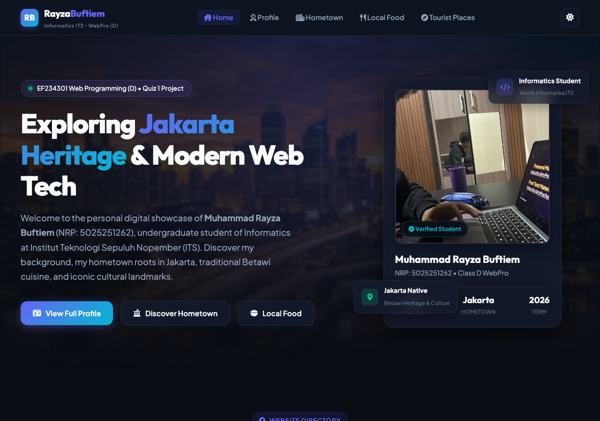
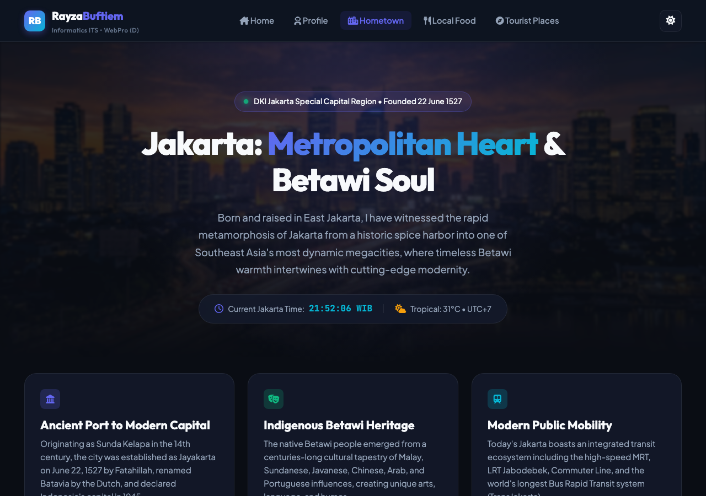
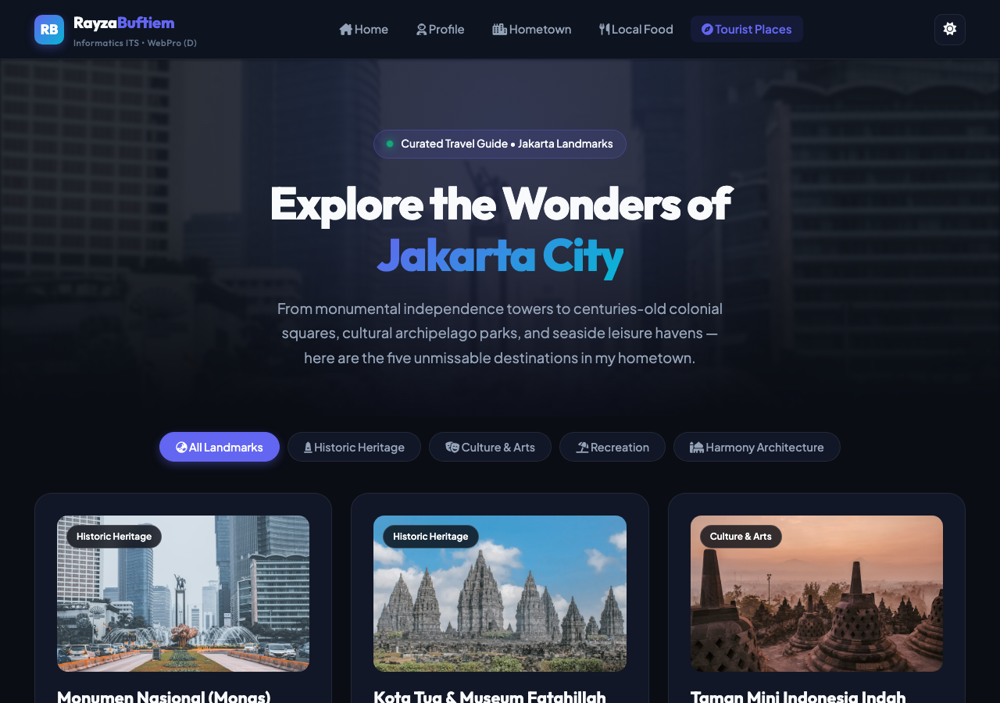

# EF234301 Web Programming (D) &mdash; Quiz 1 Project

[](https://rayzabuf.github.io/webpro-quiz1/quiz1/)
[](https://github.com/rayzabuf/webpro-quiz1)
[](https://github.com/rayzabuf)
[](https://www.its.ac.id/informatika/)

Personal website and comprehensive cultural portal celebrating the heritage of Jakarta, developed as the fulfillment of **Quiz 1** for course **EF234301 Web Programming (Class D)**, Department of Informatics, Faculty of Intelligent Electrical and Informatics Technology (FTEIC), Institut Teknologi Sepuluh Nopember (ITS), Surabaya.

---

## 👨‍💻 Student & Course Profile

| Field | Detail |
|---|---|
| **Author / Student Name** | Muhammad Rayza Buftiem |
| **Student ID (NRP)** | `5025251262` |
| **Course** | EF234301 Web Programming (D) |
| **Instructors** | MM Irfan Subakti, Callista FRG, Kevin Andreas |
| **Term** | Semester Gasal 2026/2027 |
| **Live Deployed URL** | [https://rayzabuf.github.io/webpro-quiz1/quiz1/](https://rayzabuf.github.io/webpro-quiz1/quiz1/) |
| **Public GitHub Repo** | [https://github.com/rayzabuf/webpro-quiz1](https://github.com/rayzabuf/webpro-quiz1) |

---

## 🌐 Website Architecture & Standardized Routing

The project follows a directory-based multi-page structure adhering strictly to the specification:

| Route | Page | Description |
|---|---|---|
| `(Domain)/quiz1` | **Homepage** | Overview hero, interactive student showcase card, portal bento grid directory, and course compliance checklist. |
| `(Domain)/quiz1/profile` | **Profile Page** | Academic and personal dossier, education timeline (ITS, SMA Insan Cendekia, GIS), technical skill meters, and leadership roles. |
| `(Domain)/quiz1/hometown` | **Hometown Page** | In-depth story of Jakarta, covering 497+ years from Sunda Kelapa to modern transit (MRT/LRT), Betawi culture (Ondel-ondel, Palang Pintu, Lenong), and live WIB clock. |
| `(Domain)/quiz1/food` | **Local Food Page** | Authentic Betawi culinary showcase (Soto Betawi, Kerak Telor, Asinan, Nasi Uduk, Bir Pletok) with category filters and interactive recipe modals. |
| `(Domain)/quiz1/tourist` | **Tourist Places** | Curated travel guide covering Monas, Kota Tua, TMII, Ancol, and Istiqlal/Cathedral with category filters and visitor guide modals. |

---

## 🎨 Key Features & Technical Highlights

1. **Pure Modular Vanilla Stack (Zero Framework Overhead)**:
   - Handcrafted semantic HTML5.
   - Tailored CSS design tokens (custom properties) in `quiz1/css/style.css` supporting dark-mode-first aesthetic with instant light-theme toggle.
   - Glassmorphism effects with `backdrop-filter: blur(16px)` and subtle glowing borders.
   - Fully responsive bento grid reflowing across mobile, tablet, and widescreen displays.
2. **Interactive Client-Side Logic (`quiz1/js/main.js`)**:
   - Persistent theme switcher stored in browser `localStorage`.
   - Real-time Jakarta Clock (WIB / UTC+7) dynamically computed via `Intl.DateTimeFormat`.
   - Multi-category filter algorithms for food and tourist spots with smooth CSS transform/opacity animations.
   - Accessible modal overlays with keyboard (`Escape`) and backdrop click dismissals.
   - Asynchronous clipboard copy utility with animated toast notifications.
3. **Deployment Resilience**:
   - Relative URL navigation ensures flawless operation both locally (`localhost:8080/quiz1/`) and on hosted subpaths (`username.github.io/webpro-quiz1/quiz1/`).
   - Root `index.html` provides automatic client redirection.

---

## 📸 Webpage Previews

### 1. Homepage (`/quiz1`)


### 2. Profile Page (`/quiz1/profile`)


### 3. Hometown Page (`/quiz1/hometown`)


### 4. Local Food Page (`/quiz1/food`)


### 5. Tourist Places Page (`/quiz1/tourist`)


---

## 🚀 Running Locally

To run this project on your local machine:

1. Clone the repository:
   ```bash
   git clone https://github.com/rayzabuf/webpro-quiz1.git
   cd webpro-quiz1
   ```

2. Start a local HTTP server using Python:
   ```bash
   python3 -m http.server 8080
   ```

3. Open your browser and navigate to:
   ```
   http://localhost:8080/quiz1/
   ```

---

## 📄 Submission Archive

Per the submission guidelines, the official archive is packaged as:
```
EF234301_WebPro(D)_Q1_5025251262_Muhammad Rayza Buftiem.ZIP
├── Report.PDF        (Comprehensive project documentation, code review, evaluation)
└── Declaration.PDF   (Signed Academic Integrity Pledge)
```

&copy; 2026 **Muhammad Rayza Buftiem** (NRP: 5025251262). Built for EF234301 Web Programming (D) ITS.
